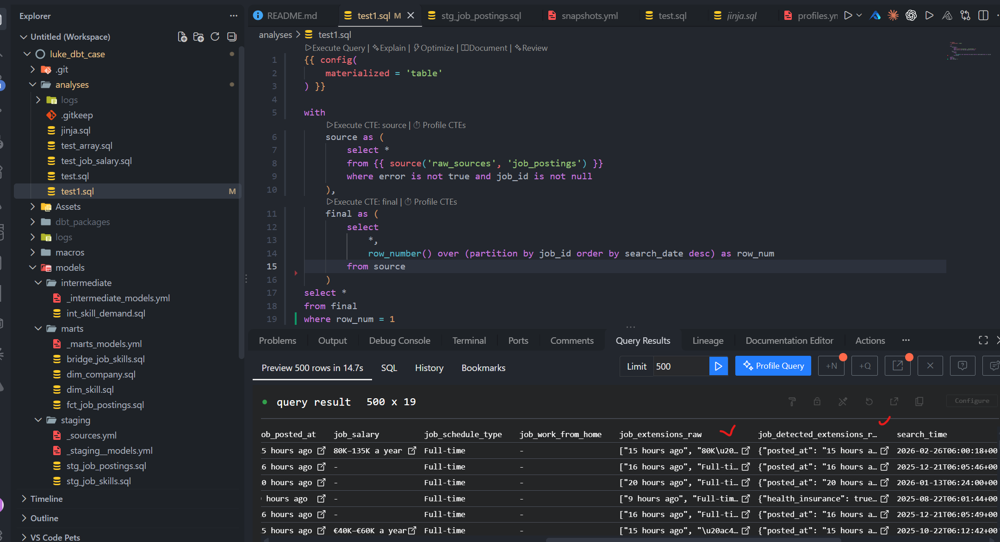
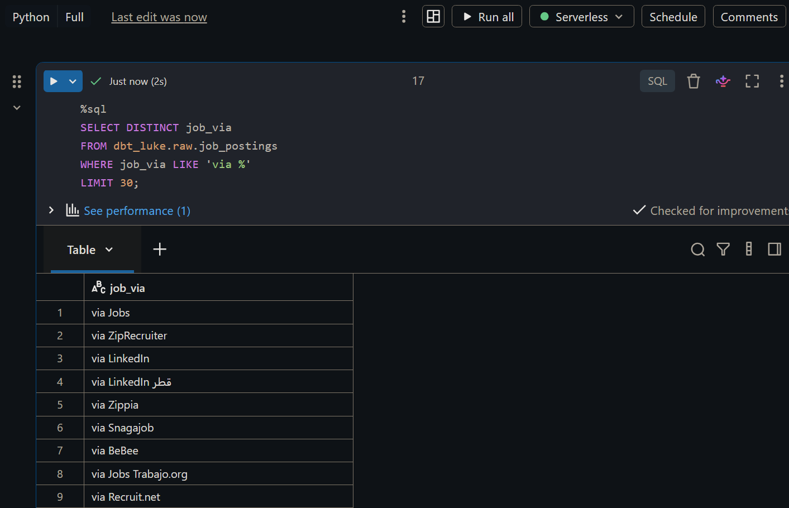
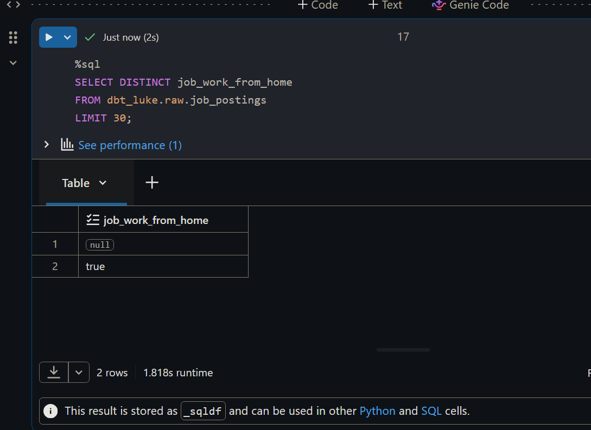
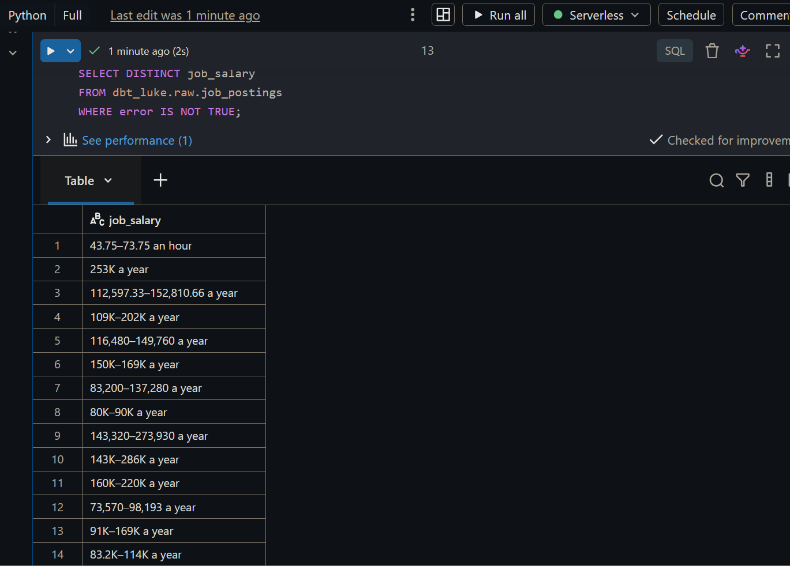
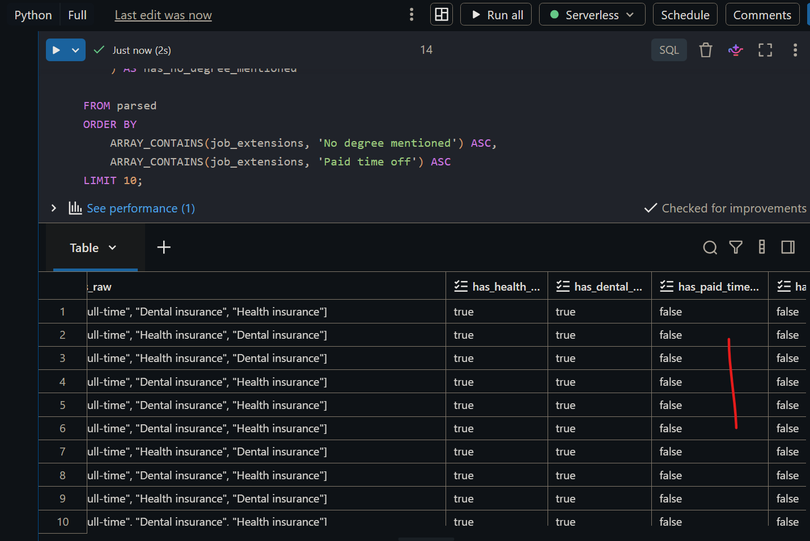
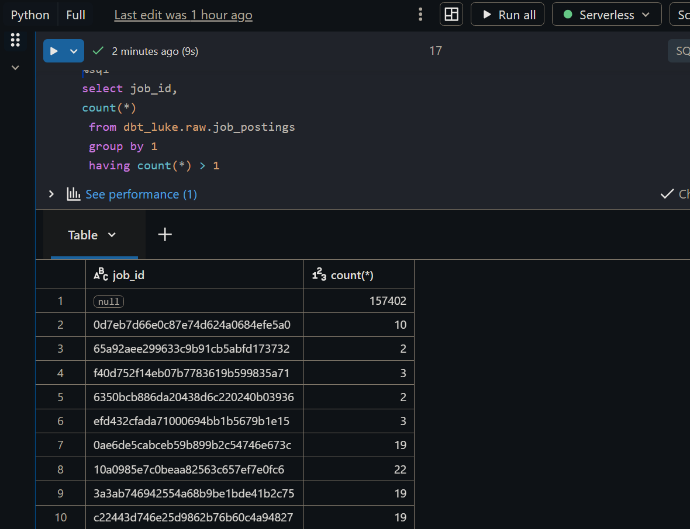
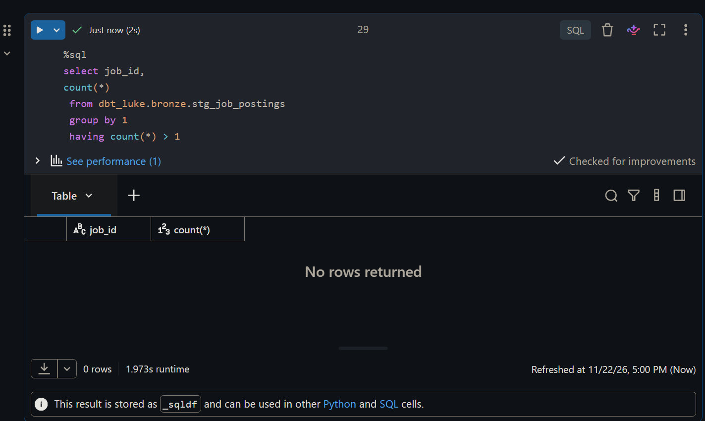
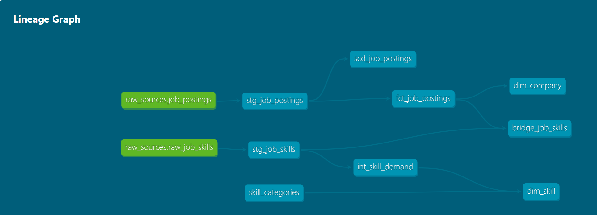

# Job Market ELT Pipeline: Ingestion, Profiling & Data Quality

## 📖 Overview
This document records the critical data engineering concepts, ingestion strategies, and architectural decisions applied in this project. It highlights the solutions to common data quality pitfalls, from raw Parquet ingestion to Staging layer deduplication and semi-structured data cleaning.

---

## 1. Raw Ingestion Strategy (Source Layer)

### 1.1 Automated File Download to Volume
**Solution**: Use Python `urllib` to stream-download 12 months of `.parquet` files directly into a Volume `source` directory.

```python
import urllib.request, os
VOLUME = "/Volumes/dbt_luke/raw/source/job_postings"
FILES = [
    "raw_job_postings_2025-07.parquet", "raw_job_postings_2025-08.parquet",
    "raw_job_postings_2025-09.parquet", "raw_job_postings_2025-10.parquet",
    "raw_job_postings_2025-11.parquet", "raw_job_postings_2025-12.parquet",
    "raw_job_postings_2026-01.parquet", "raw_job_postings_2026-02.parquet",
    "raw_job_postings_2026-03.parquet", "raw_job_postings_2026-04.parquet",
    "raw_job_postings_2026-05.parquet", "raw_job_postings_2026-06.parquet"
]
REPO = "lukebarousse/dbt_Analytics_Engineering_Course"
TAG = "dataset-v1"

for name in FILES:
    dest = f"{VOLUME}/{name}"
    if os.path.exists(dest): continue
    url = f"https://github.com/{REPO}/releases/download/{TAG}/{name}"
    urllib.request.urlretrieve(url, dest)
```

### 1.2 Internal Storage Registration
Register Parquet files into the `raw` schema:

```sql
-- Register raw_job_skills table
CREATE OR REPLACE TABLE dbt_luke.raw.raw_job_skills AS
SELECT * FROM parquet.`/Volumes/dbt_luke/raw/source/raw_job_skills.parquet`;

-- Register job_postings table
CREATE OR REPLACE TABLE dbt_luke.raw.job_postings AS
SELECT * FROM read_files('/Volumes/dbt_luke/raw/source/job_postings/*.parquet', format => 'parquet')
```

### 1.3 Batch Preview with Python Loop
Avoid Databricks UI overwriting `display()`:

```python
tables = ["job_postings", "raw_job_skills"]

for t in tables:
    print(f"================ {t.upper()} ================")
    display(spark.read.table(f"dbt_luke.raw.{t}").limit(5))
```

### 1.4 Reference Data via `dbt seed`
`skill_categories` loaded via `dbt seed` from local CSV.

---

---

## 2. Data Profiling & Exploration

### 2.1 Search Term Distribution
*(Corresponds to video at 04:38:00)*
```sql
SELECT search_term, COUNT(*) AS total
FROM dbt_luke.raw.job_postings
WHERE error IS NOT TRUE
GROUP BY 1 ORDER BY total DESC;
```
**Results**: Data Engineer (413,320), Data Analyst (176,350), Data Scientist (102,280).

### 2.2 Boolean Field Profiling (Crucial Discovery)
```sql
SELECT DISTINCT job_work_from_home 
FROM dbt_luke.raw.job_postings 
WHERE error IS NOT TRUE;
```
**Result**: Natively **Boolean**, only `true` and `null` (no `false`).

---

---

## 3. Deep Dive: stg_job_postings (dbt Bronze / Staging)

**Development Evolution — From Initial Staging to Advanced Transformations**

The initial Staging model focused on basic data cleaning and grain enforcement:

- Excluding failed scraping records using `error IS NOT TRUE`.
- Removing records with missing business keys using `job_id IS NOT NULL`.
- Applying `ROW_NUMBER() = 1` to establish one row per `job_id`.



*Figure: Initial Staging implementation, focusing on validity filtering and deduplication before additional transformations were introduced.*

**Further Raw Data Profiling — Two Key Findings**

After implementing the initial Staging model, further inspection of the Raw dataset revealed two columns that required more advanced transformations:

**1. `job_salary` — Inconsistent Salary Text**

The `job_salary` column contains salary information in different text formats, including ranges, abbreviations such as `K` and `M`, different currencies, and different payment periods.

These values could not be reliably aggregated or compared as numeric salaries without additional parsing.

This led to the development of the reusable `parse_salary` macro, which extracts `salary_min` and `salary_max`, alongside SQL transformations for `salary_avg`, `salary_period`, and `salary_currency`.

**2. `job_extensions_raw` — Semi-Structured JSON Arrays**

The `job_extensions_raw` column contains JSON arrays with job-related attributes, including benefits such as health insurance, dental insurance, and paid time off.

These attributes were embedded within arrays rather than available as individual analytical columns.

This led to the use of `FROM_JSON()` to parse the array and the reusable `unpack_extensions` macro to generate boolean benefit indicators.

**Engineering Outcome**

The Staging model evolved from a simple filtering and deduplication query into a more complete transformation layer that combines data cleaning, salary normalization, JSON parsing, reusable dbt macros, and business-key grain enforcement.

The following sections explain these transformations in detail, particularly the salary parsing logic in Section 3.3 and JSON array processing in Section 3.4.

### 3.1 Text Prefix Cleaning

**Problem:** Raw data inspection revealed that the `job_via` column contains a redundant `via ` prefix in source platform names, such as `via LinkedIn` and `via ZipRecruiter`.

**Data Profiling:**

```sql
SELECT DISTINCT job_via
FROM dbt_luke.raw.job_postings
WHERE job_via LIKE 'via %'
LIMIT 30;
```



*Figure: Raw data profiling confirms the presence of redundant `via ` prefixes.*

**Solution:**

```sql
REGEXP_REPLACE(job_via, '^via ', '') AS source_platform
```

**Result:** Standardized source platform names by removing the leading `via ` prefix.

For example, `via LinkedIn` becomes `LinkedIn`, making the values cleaner for downstream reporting and grouping.

### 3.2 Defensive Boolean Casting

**Data Profiling:** Inspection of the Raw `job_work_from_home` column revealed only two distinct values: `true` and `NULL`.

```sql
SELECT DISTINCT job_work_from_home
FROM dbt_luke.raw.job_postings;
```



*Figure: Raw data profiling showing true and NULL values.*

**Design Decision:** Applied defensive boolean casting to handle potential future variations in source data while preserving missing or unrecognized values as `NULL`.

```sql
CASE
    WHEN LOWER(TRIM(CAST(job_work_from_home AS STRING))) = 'true' THEN TRUE
    WHEN LOWER(TRIM(CAST(job_work_from_home AS STRING))) = 'false' THEN FALSE
    ELSE NULL
END AS job_work_from_home
```

**Business Rationale:** Missing remote-work information does not necessarily mean remote work is unavailable. Preserving `NULL` avoids incorrectly classifying unknown values as `false`.

**Result:** A standardized nullable boolean field that preserves the distinction between confirmed and unknown remote-work status.

### 3.3 Complex Salary Text Extraction

**Problem — Inconsistent Salary Formats**

Raw data profiling revealed that `job_salary` contains semi-structured salary information with different numeric formats and payment periods.

**Data Profiling:**

```sql
SELECT DISTINCT job_salary
FROM dbt_luke.raw.job_postings
WHERE error IS NOT TRUE;
```



*Figure: Raw salary values showing hourly and yearly pay periods, K abbreviations, salary ranges, and different numeric formats.*

The key challenges identified were:

- **Different payment periods:** `43.75–73.75 an hour` versus `109K–202K a year`.
- **Abbreviated numbers:** `253K` represents 253,000.
- **Salary ranges:** Values such as `109K–202K` require minimum and maximum salary extraction.
- **Numeric formatting:** Values may contain commas and decimals, such as `112,597.33–152,810.66 a year`.

**Solution — Reusable Salary Parsing Macro and SQL Transformations**

A custom dbt macro, `parse_salary`, was implemented to:

- Extract minimum and maximum salaries from ranges, or handle single-value salaries.
- Handle different range delimiters (`-`, `~`, `–`).
- Recognize `K` and `M` multipliers and convert abbreviated values into numeric amounts.
- Remove thousands separators and use `TRY_CAST` for safe numeric conversion.

Additional transformations in `stg_job_postings.sql`:

- **Salary period:** Extract `year`, `hour`, `month`, `day`, or `week` using `REGEXP_EXTRACT`.
- **Salary currency:** Extract leading currency symbols or text, defaulting to `USD` when a non-null salary has no currency prefix.
- **Average salary:** Calculate the midpoint of `salary_min` and `salary_max`.

**Result — Structured Salary Columns**

The final Staging model produces:

- `salary_min`
- `salary_max`
- `salary_avg`
- `salary_period`
- `salary_currency`

The original `job_salary` column is retained for traceability and validation.

**Engineering Consideration:** Hourly and yearly salaries cannot be directly compared. The Staging model extracts the payment period but does not automatically convert salaries into a common annual amount.

### 3.4 JSON Array Parsing with Custom Macro

**Problem — Semi-Structured Job Extensions**

Raw data profiling revealed that `job_extensions_raw` contains JSON arrays stored as strings, including job benefits, employment types, and posting information.

**Data Profiling:**

```sql
SELECT DISTINCT job_extensions_raw
FROM dbt_luke.raw.job_postings
WHERE error IS NOT TRUE;
```

The key challenges identified were:

- **Semi-structured data:** Benefits such as `Health insurance`, `Dental insurance`, and `Paid time off` are embedded in JSON arrays.
- **Variable element ordering:** The same benefits may appear in different positions within an array.
- **Missing values:** Some records contain `NULL` instead of a JSON array.
- **Analytical usability:** Individual benefits need to be converted into structured columns for downstream analysis.

**Solution — FROM_JSON and Reusable dbt Macro**

First, the JSON string is parsed into an array using Databricks `FROM_JSON`:

```sql
FROM_JSON(job_extensions_raw, 'array<string>') AS job_extensions
```

A reusable dbt macro, `unpack_extensions`, then converts selected array elements into boolean columns:

```sql

    
        coalesce(
            array_contains({{ array_col }}, '{{ kw }}'), false
        ) as has_{{ kw | replace(' ', '_') | lower }}
        ,
    

```

**One-line Macro Call:**

```sql
{{ unpack_extensions('job_extensions', [
    'Health insurance',
    'Dental insurance',
    'Paid time off',
    'No degree mentioned'
]) }}
```

**Validation — Before vs. After Transformation**

To validate the transformation, I expanded the dbt macro logic into a standalone Databricks SQL query. This allows the original JSON string and the resulting boolean columns to be compared side by side.

```sql
WITH parsed AS (
    SELECT
        job_id,
        job_extensions_raw,
        FROM_JSON(
            job_extensions_raw,
            'array<string>'
        ) AS job_extensions
    FROM dbt_luke.raw.job_postings
    WHERE error IS NOT TRUE
      AND job_id IS NOT NULL
      AND job_extensions_raw IS NOT NULL
)

SELECT
    job_id,
    job_extensions_raw,

    COALESCE(
        ARRAY_CONTAINS(job_extensions, 'Health insurance'), FALSE
    ) AS has_health_insurance,

    COALESCE(
        ARRAY_CONTAINS(job_extensions, 'Dental insurance'), FALSE
    ) AS has_dental_insurance,

    COALESCE(
        ARRAY_CONTAINS(job_extensions, 'Paid time off'), FALSE
    ) AS has_paid_time_off,

    COALESCE(
        ARRAY_CONTAINS(job_extensions, 'No degree mentioned'), FALSE
    ) AS has_no_degree_mentioned

FROM parsed
ORDER BY
    ARRAY_CONTAINS(job_extensions, 'No degree mentioned') ASC,
    ARRAY_CONTAINS(job_extensions, 'Paid time off') ASC
LIMIT 10;
```



*Figure: Validation of JSON array parsing, showing how selected benefits are converted into true/false indicators based on keyword presence.*

**Result — Structured Boolean Columns**

The transformation converts selected JSON array elements into four analytical boolean columns:

- `has_health_insurance`
- `has_dental_insurance`
- `has_paid_time_off`
- `has_no_degree_mentioned`

These fields can be used directly in downstream analysis without repeatedly parsing the original JSON strings.

**Engineering Consideration**

- **Order independence:** `ARRAY_CONTAINS` identifies keywords regardless of their position in the array.
- **Reusability:** The `unpack_extensions` macro avoids repetitive SQL and simplifies maintenance.
- **NULL handling:** `COALESCE(..., FALSE)` converts missing arrays and unmatched keywords into `false`, producing consistent non-null boolean indicators.

**Business Trade-off:** A `false` value means that a benefit was not identified in the source array. It does not necessarily mean the employer does not offer that benefit.

**Grain Preservation**

The transformation uses `FROM_JSON` and `ARRAY_CONTAINS` rather than `EXPLODE` to extract job benefits.

This approach converts semi-structured attributes into boolean columns without creating additional rows or changing the existing record-level grain.

As a result, the Staging model maintains **one row per `job_id`**, as enforced by the separate deduplication logic, while exposing benefit attributes for downstream analysis.

### 3.5 Deduplication — Raw Duplicate Detection & Grain Enforcement

Before implementing deduplication, I profiled the raw `job_postings` table to identify missing and duplicate business keys.

```sql
SELECT
    job_id,
    COUNT(*) AS duplicate_count
FROM dbt_luke.raw.job_postings
GROUP BY job_id
HAVING COUNT(*) > 1
ORDER BY duplicate_count DESC;
```



*Figure: Raw data profiling shows 157,402 records with NULL `job_id`, while several non-null job IDs appear multiple times (up to 22 times among the displayed results).*

This highlights two data quality concerns:

- **Missing business keys:** Records without `job_id` cannot be reliably identified as individual job postings.
- **Duplicate business keys:** The same job posting may appear in multiple searches or scraping runs.

To address these issues, the Staging model first filters invalid records:

```sql
WHERE error IS NOT TRUE
  AND job_id IS NOT NULL
```

It then applies window-based deduplication:

```sql
ROW_NUMBER() OVER (
    PARTITION BY job_id
    ORDER BY search_date DESC
) AS row_num
```

Only records with `row_num = 1` are retained, enforcing the intended Staging grain of **one row per `job_id`**.

**Validation — Staging Grain Verification**

After applying deduplication, I validated the Staging table to confirm that no duplicate `job_id` values remained.

```sql
SELECT
    job_id,
    COUNT(*) AS duplicate_count
FROM dbt_luke.bronze.stg_job_postings
GROUP BY job_id
HAVING COUNT(*) > 1;
```



*Figure: The query returns zero rows, confirming that no duplicate `job_id` values remain in the Staging table.*

**Result:** The Staging layer successfully enforces the intended grain of one row per `job_id`, providing a unique input for downstream Fact modeling and SCD2 snapshots.

This is particularly important because the downstream dbt Snapshot uses `job_id` as its `unique_key`. Each Snapshot execution requires at most one current input record per business key to reliably detect changes and maintain SCD2 history.

**Engineering takeaway:** Raw data can contain missing and repeated business keys. By validating identifiers and deduplicating before downstream modeling, the Staging layer establishes a consistent grain and reduces the risk of duplicate records propagating into analytical models.

#### Design Comparison — Reference Tutorial vs. My Implementation

The reference tutorial separates historical scrape observations from the current state of each job posting:

- `stg_job_postings` retains repeated scrape observations after filtering invalid records.
- `stg_job_postings_current` is an ephemeral model that uses an `as_of` date filter and `ROW_NUMBER() = 1` to select the latest observation per `job_id`.
- The SCD2 Snapshot reads from `stg_job_postings_current`, using `job_id` as its unique key.

In my implementation, the Raw layer already preserves the original source records. Therefore, I chose to apply deduplication directly in `stg_job_postings`, rather than introducing an additional current-state model.

This ensures that the Staging layer has a consistent grain of **one row per `job_id`**, providing a unique input for downstream SCD2 snapshots and simplifying subsequent transformations.

**Trade-off:** The reference design supports selecting historical current states using an `as_of` cutoff, while my design prioritizes a simpler current-state pipeline. Historical raw observations remain available for reprocessing, but intermediate changes between Snapshot executions are not automatically captured.

Both approaches are valid for their respective objectives; the main difference is where current-state selection and deduplication occur.

### 3.6 Reconciliation: Data Funnel
```sql
SELECT 
    COUNT(*) AS total_rows_raw,
    COUNT(CASE WHEN error IS NOT TRUE THEN 1 END) AS total_rows_valid1,
    COUNT(CASE WHEN error IS NOT TRUE AND job_id IS NOT NULL THEN 1 END) AS total_rows_valid,
    (SELECT COUNT(*) FROM dbt_luke.bronze.stg_job_postings) AS total_rows_bronze
FROM dbt_luke.raw.job_postings;
```
**Audit Results**:
- Source Total: **843,097**
- Valid after error filter: **691,950**
- Valid after null ID filter: **685,695**
- Final Bronze rows: **491,140**

### 3.7 Bronze Layer Full Table Reconciliation
```sql
SELECT 'job_postings' AS table_name, COUNT(*) AS total_rows FROM dbt_luke.bronze.stg_job_postings
UNION ALL
SELECT 'raw_job_skills', COUNT(*) FROM dbt_luke.bronze.stg_job_skills
UNION ALL
SELECT 'skill_categories', COUNT(*) FROM dbt_luke.bronze.skill_categories;
```

---

---

## 4. Staging Data Quality Testing

**Problem — Data Integrity and Referential Consistency**

After cleaning and deduplicating the Staging models, data quality tests were required to validate the intended grain and relationships between datasets.

The key requirements were:

- **Uniqueness:** Each `job_id` in `stg_job_postings` and each `skill_id` in `skill_categories` must be unique.
- **Completeness:** Required identifiers and skill descriptions must not contain `NULL` values.
- **Referential Integrity:** Every `job_id` and `skill_id` in `stg_job_skills` must reference a valid parent record.

**Solution — dbt Generic Data Tests**

Implemented **9 generic data tests** in `_staging_models.yml`:

```yaml
version: 2

models:
  - name: stg_job_postings
    columns:
      - name: job_id
        data_tests:
          - unique
          - not_null

  - name: stg_job_skills
    columns:
      - name: job_id
        data_tests:
          - not_null
          - relationships:
              to: ref('stg_job_postings')
              field: job_id
      - name: skill_id
        data_tests:
          - not_null
          - relationships:
              to: ref('skill_categories')
              field: skill_id

  - name: skill_categories
    columns:
      - name: skill_id
        data_tests:
          - unique
          - not_null
      - name: display_name
        data_tests:
          - not_null
```

**Test Coverage**

| Test Type | Count | Purpose |
|---|---:|---|
| `unique` | 2 | Validate unique business keys |
| `not_null` | 5 | Ensure required fields are populated |
| `relationships` | 2 | Validate referential integrity |
| **Total** | **9** | |

**Validation — Targeted Execution**

```bash
dbt test --select stg_job_postings stg_job_skills skill_categories --exclude test_type:singular
```

**Execution Result:**

```text
PASS=9 WARN=0 ERROR=0 SKIP=0 TOTAL=9
```

All 9 generic tests passed, confirming that the selected Staging models satisfied the configured uniqueness, non-null, and referential integrity checks at execution time.

**Engineering Consideration — Grain Validation**

The `unique` and `not_null` tests on `stg_job_postings.job_id` provide an automated check of the intended Staging grain: **one row per `job_id`**.

The `stg_job_skills` model does not enforce uniqueness on individual `job_id` or `skill_id` columns because multiple skills can be associated with a single job, and a skill can appear across multiple jobs.

The `relationships` tests verify that skill mappings reference existing job postings and skill categories, helping prevent orphaned records in downstream transformations.

### 4.1 Singular Test: Salary Anomaly Monitoring

During data profiling, we identified extreme salary values (e.g., annual salaries over $1,000,000). Throwing a hard `ERROR` for these in the pipeline would break the entire build; however, ignoring them would severely skew the average salary calculations in BI dashboards.

Therefore, we created a **Singular Test (`assert_salaries_sane`)** and configured it as a **WARN** level:

- **Test Logic**: Flags records where `salary_period = 'year'`, `salary_currency = 'USD'`, and `salary_max >= 1,000,000`.
- **Business Insight**: Without the USD filter, cross-currency aggregation triggers 7,232 false alarms (currencies like INR ₹, ZAR, and PKR naturally use 7-figure numbers). By pinning it to USD, the anomalies drop to just 21 rows.
- **Root Cause Analysis**: Most of these 21 rows are employer data entry errors (e.g., a role at Kobie Marketing legitimately ranged from 90K–125K, but one scrape mistakenly recorded it as 800K–1M).
- **Handling Strategy**: Set to `severity = 'warn'` instead of `error`. This represents **data reality**, not a broken pipeline. The test results are used to pinpoint dirty data sources precisely without blocking the data flow.

```sql
-- assert_salaries_sane.sql
{{ config(severity = 'warn') }}

SELECT
    job_id,
    company_name,
    job_title,
    salary_min,
    salary_max,
    salary_period,
    salary_currency,
    searched_at
FROM {{ ref('stg_job_postings') }}
WHERE salary_period = 'year'
  AND salary_currency = 'USD'
  AND COALESCE(salary_max, salary_min) >= 1000000
```

---

## 5. Intermediate Layer: Skill Demand Aggregation & Fan-out Prevention

The Intermediate layer transforms detailed job-skill relationships into aggregated skill demand metrics before building the Gold Skill Dimension.

### 5.1 Data Profiling: Duplicate Job-Skill Associations

The `stg_job_skills` model contains job-skill associations at the grain of `(job_id, skill_id, skill_keyword)`.

A single job may contain multiple keywords referring to the same skill. Therefore, `(job_id, skill_id)` is not necessarily unique.

To identify these variations, I compared the total number of job-skill observations with the number of distinct jobs for each skill:

```sql
SELECT
    skill_id,
    COUNT(job_id) AS total_job_per_skill,
    COUNT(DISTINCT job_id) AS unique_job_per_skill,
    COUNT(job_id) - COUNT(DISTINCT job_id) AS duplicate_observations
FROM {{ ref('stg_job_skills') }}
GROUP BY skill_id
ORDER BY duplicate_observations DESC;
```

**Engineering Finding**

Multiple observations for the same job-skill pair do not necessarily indicate invalid data. They may represent legitimate keyword variations.

However, using `COUNT(job_id)` directly would overstate skill demand.

**Design Decision:** Use `COUNT(DISTINCT job_id)` to measure how many unique job postings require each skill.

### 5.2 Intermediate Model: `int_skill_demand`

The Intermediate model aggregates millions of job-skill observations into one row per `skill_id`.

```sql
SELECT
    skill_id,
    COUNT(DISTINCT job_id) AS postings_with_skill
FROM {{ ref('stg_job_skills') }}
GROUP BY skill_id
```

**Why Aggregate Before Joining?**

Joining detailed job-skill records directly with `skill_categories` would produce multiple rows per skill, violating the intended grain of `dim_skill`.

Instead, `int_skill_demand` aggregates the data first.

This provides three benefits:

- **Grain preservation:** One row per `skill_id` before joining the Skill Dimension.
- **Accurate demand:** `COUNT(DISTINCT job_id)` avoids double-counting keyword variations.
- **Reduced data volume:** Millions of detailed associations are summarized into a much smaller aggregated model.

**Engineering Takeaway**

The Intermediate layer separates detailed job-skill relationships from skill-level demand metrics. Aggregating to the required grain before joining prevents unintended row multiplication in `dim_skill`.

---

## 6. Data Modeling & Marts Layer (Gold)

The Gold layer provides BI-ready analytical models built from cleaned Staging data and aggregated Intermediate results.

The design consists of a Job Fact, Company and Skill Dimensions, a Job-Skill Bridge, and a separate SCD2 Snapshot for historical tracking.

### 6.1 End-to-End dbt Lineage & Model Dependencies

The following DAG was generated using `dbt docs` and illustrates the actual dependencies from raw sources to Gold models and historical snapshots.



*Figure 1: End-to-End dbt Lineage — Raw Sources, Staging, Intermediate, Gold Models, and SCD2 Snapshot.*

| Model | Upstream Dependencies | Grain |
|---|---|---|
| `fct_job_postings` | `stg_job_postings` | One row per `job_id` |
| `dim_company` | `fct_job_postings` | One row per `company_name` |
| `dim_skill` | `skill_categories`, `int_skill_demand` | One row per `skill_id` |
| `bridge_job_skills` | `stg_job_skills`, `fct_job_postings` | One row per `(job_id, skill_id, skill_keyword)` |
| `scd_job_postings` | `stg_job_postings` | Historical versions per `job_id` |

**Key Architectural Decisions**

- **Fact-first dependencies:** `fct_job_postings` must be built before `dim_company` and `bridge_job_skills`.
- **Grain-aware aggregation:** `int_skill_demand` aggregates job-skill observations before constructing `dim_skill`, preventing join fan-out.
- **Bridge alignment:** `bridge_job_skills` references the Gold Fact to retain only associations belonging to existing Fact records.
- **Independent SCD2 tracking:** `scd_job_postings` reads directly from Staging, separating historical tracking from incremental Fact processing.

**Engineering Takeaway**

dbt uses `ref()` and `source()` dependencies to construct a Directed Acyclic Graph (DAG), determining the correct model execution order.

The DAG explains why some Gold models depend on the Fact while others can be built independently.

### 6.2 Star Schema Design

The analytical model separates job postings, descriptive dimensions, and many-to-many skill relationships.

- **Fact Table — `fct_job_postings`:** Contains one row per job posting, including salary, benefits, company name, and other job attributes.
- **Company Dimension — `dim_company`:** Contains one row per company name, with aggregated job posting counts and comparable salary metrics.
- **Skill Dimension — `dim_skill`:** Contains one row per skill, including skill classifications and demand counts.
- **Bridge Table — `bridge_job_skills`:** Connects job postings with their associated skills while preserving keyword variations.

**Why a Bridge Table?**

One job can require multiple skills, and one skill can appear in multiple jobs.

This creates a many-to-many relationship.

The Bridge stores these associations separately so the Fact table can retain its intended grain of one row per job posting.

### 6.3 Incremental Fact Model: `fct_job_postings`

The Fact table is materialized incrementally using the `merge` strategy and `job_id` as its business key.

**Design Objectives**

- Maintain one current row per `job_id`.
- Deduplicate incoming records before merging.
- Process recent source records incrementally.
- Validate uniqueness and completeness using dbt tests.

The source records are deduplicated using:

```sql
QUALIFY ROW_NUMBER() OVER (
    PARTITION BY job_id
    ORDER BY search_date DESC, searched_at DESC
) = 1
```

**Engineering Consideration**

Deduplication ensures that each incremental source batch contains at most one row per `job_id`.

However, `unique_key` alone does not enforce physical uniqueness in the target table. Incremental merge conditions must also allow existing records to be matched correctly.

The Gold-layer `unique` and `not_null` tests provide additional validation of the resulting Fact table.

### 6.4 Company Dimension: `dim_company`

The Company Dimension is derived from `fct_job_postings`.

```sql
WITH job_postings AS (
    SELECT *
    FROM {{ ref('fct_job_postings') }}
)

SELECT
    company_name,
    COUNT(*) AS total_job_postings,
    ROUND(
        AVG(
            CASE
                WHEN salary_currency = 'USD'
                 AND salary_period = 'year'
                THEN salary_avg
            END
        ),
        2
    ) AS avg_salary_year
FROM job_postings
WHERE company_name IS NOT NULL
GROUP BY company_name
```

**Design Decision**

The Company Dimension uses `company_name` as its grain because the available source data does not provide an independent company master identifier.

Salary averages are restricted to USD annual salaries to avoid mixing different currencies and payment periods.

**Architecture Limitation**

Because `dim_company` is derived directly from the Fact, testing whether every non-null Fact company exists in the Dimension provides limited additional assurance under the current transformation logic.

In a production environment, an independent company master dataset or CRM source would provide stronger entity management and referential validation.

### 6.5 Skill Dimension: `dim_skill`

The Skill Dimension combines reference skill metadata with aggregated demand metrics.

```sql
WITH skill_categories AS (
    SELECT *
    FROM {{ ref('skill_categories') }}
),

observations AS (
    SELECT *
    FROM {{ ref('int_skill_demand') }}
)

SELECT
    skill_id,
    display_name,
    category,
    subcategory,
    COALESCE(postings_with_skill, 0) AS postings_with_skill
FROM skill_categories
LEFT JOIN observations USING (skill_id)
ORDER BY postings_with_skill DESC
```

**Design Decision**

The `LEFT JOIN` retains all skills from the reference dataset, including skills with no observed job postings.

Because both inputs contain at most one row per `skill_id`, the join preserves the intended Skill Dimension grain.

`COALESCE` converts missing demand counts to zero.

**Engineering Takeaway**

Pre-aggregating demand in the Intermediate layer avoids joining millions of detailed job-skill records directly into the Skill Dimension.

### 6.6 Bridge Table: Many-to-Many Relationships & Grain

**Bridge Table Purpose**

The `bridge_job_skills` model connects job postings in `fct_job_postings` with skills represented in `dim_skill`.

The Bridge is constructed from `stg_job_skills` and aligned with the Gold Fact using an `INNER JOIN`.

```sql
WITH job_skills AS (
    SELECT
        job_id,
        skill_id,
        skill_keyword
    FROM {{ ref('stg_job_skills') }}
),

job_postings AS (
    SELECT job_id
    FROM {{ ref('fct_job_postings') }}
)

SELECT
    p.job_id,
    s.skill_id,
    s.skill_keyword
FROM job_skills s
INNER JOIN job_postings p
    ON s.job_id = p.job_id
```

**Grain Design**

The Bridge grain is:

`(job_id, skill_id, skill_keyword)`

A single `(job_id, skill_id)` pair may have multiple keyword variations, such as `pub/sub`, `google pub`, and `pubsub`.

Testing uniqueness only on `(job_id, skill_id)` would incorrectly classify these legitimate variations as duplicates.

Therefore, the composite uniqueness test includes all three columns.

**Bridge Test Configuration**

```yaml
- name: bridge_job_skills
  description: "Bridge table mapping jobs to skills, retaining keyword variations."
  data_tests:
    - dbt_utils.unique_combination_of_columns:
        combination_of_columns:
          - job_id
          - skill_id
          - skill_keyword

  columns:
    - name: job_id
      data_tests:
        - not_null
        - relationships:
            to: ref('fct_job_postings')
            field: job_id

    - name: skill_id
      data_tests:
        - not_null
        - relationships:
            to: ref('dim_skill')
            field: skill_id
```

**Engineering Reflection — Why Join the Fact Instead of Using Staging Directly?**

Initially, I assumed `bridge_job_skills` could simply reuse `stg_job_skills`, since both models have the same columns and grain.

However, joining with `fct_job_postings` ensures that every job-skill association in the Gold Bridge references a job present in the Gold Fact.

In the current dataset, the join retains the same records because the Staging relationships tests pass and the Fact contains the same set of job IDs.

Nevertheless, this approach keeps the Bridge aligned with the Fact if future incremental processing, filtering, or synchronization differences occur.

**Trade-off:** Unmatched associations are silently excluded by the `INNER JOIN`, so relationship tests and reconciliation remain necessary to detect unexpected data loss.

**Engineering Takeaway**

Staging tests validate source-level relationships, while the Gold Bridge aligns job-skill associations with the Fact table's actual job population.

### 6.7 Gold Layer Data Quality Validation

After building the Marts models, 14 generic tests were executed to validate the Gold layer.

**Test Coverage**

| Validation | Purpose |
|---|---|
| `unique` / `not_null` | Validate Fact and Dimension business keys |
| `dbt_utils.unique_combination_of_columns` | Validate Bridge grain |
| `relationships` | Validate Bridge references to Fact and Skill Dimension |
| `non_negative` | Validate non-negative salary metrics |

**Execution Result**

```text
PASS=14 WARN=0 ERROR=0 SKIP=0 TOTAL=14
```

All 14 Gold-layer tests passed.

This confirms that the current Marts data satisfies the configured business-key, grain, referential integrity, and salary validation rules.

### 6.8 Historical Tracking: SCD Type 2 Snapshot

The project uses a separate dbt Snapshot to track changes in job posting attributes over time.

Rather than applying historical versioning directly to the incremental Fact table, the Snapshot reads from the deduplicated Staging model.

```sql

    {{ config(
      target_schema='snapshots',
      unique_key='job_id',
      strategy='check',
      check_cols=[
        'search_term', 'search_date', 'search_location',
        'job_title', 'company_name', 'job_location',
        'source_platform', 'job_schedule_type',
        'job_work_from_home', 'job_posted_at',
        'job_salary', 'salary_min', 'salary_max',
        'salary_avg', 'salary_period', 'salary_currency',
        'has_health_insurance', 'has_dental_insurance',
        'has_paid_time_off', 'has_no_degree_mentioned'
      ]
    )}}

    SELECT *
    FROM {{ ref('stg_job_postings') }}


```

**Why Snapshot Staging Instead of the Fact?**

The Snapshot tracks changes in the latest deduplicated job state independently of the Fact table's incremental merge logic.

The Fact supports current-state analytics, while the Snapshot maintains historical versions when monitored attributes change.

Under the `check` strategy, dbt compares the configured `check_cols` to detect changes.

**Trade-off:** The Snapshot only captures changes visible at execution time. Intermediate changes between Snapshot runs may be missed.

### 6.9 Practical Verification: SCD2 Change Tracking

To validate the Snapshot, I simulated a source data change.

**1. Initial State**

A `Senior Data Engineer` posting at `Fraser Health` had `job_work_from_home = NULL`.

An initial `dbt snapshot` execution recorded the first version.

**2. Simulate Source Change**

```sql
UPDATE dbt_luke.raw.job_postings
SET job_work_from_home = TRUE
WHERE job_title = 'Senior Data Engineer'
  AND company_name = 'Fraser Health';
```

**3. Rebuild Staging and Run Snapshot**

```bash
dbt run --select stg_job_postings
dbt snapshot
```

**4. Validate Historical Versions**

The Snapshot recorded two versions for the changed job:

- **Previous version:** `job_work_from_home = NULL`, with `dbt_valid_to` populated.
- **Current version:** `job_work_from_home = TRUE`, with `dbt_valid_to = NULL`.

**Result**

The test demonstrated that the Snapshot can expire an existing version and insert a new current version when a monitored attribute changes.

### 6.10 SCD2 Tracking Boundary: Raw Data vs. Snapshot History

The Snapshot does not automatically preserve every historical scraping observation.

Instead, it records changes in the latest job state presented by `stg_job_postings` during each Snapshot execution.

**Layer Responsibilities**

- **Raw Layer:** Stores source observations available for ingestion and reprocessing.
- **Staging Layer:** Cleans and deduplicates records to one latest row per `job_id`.
- **Snapshot Layer:** Compares the current Staging state with previously captured versions and maintains SCD2 validity periods.

**Engineering Takeaway**

SCD2 Snapshots provide historical state tracking, but their completeness depends on the source state and execution frequency.

The separation between the incremental Fact and the Snapshot allows current-state analytics and historical change tracking to serve different purposes without combining both responsibilities in one model.

---

## 7. Data Quality Audit: Reconciliation & Engineering Trade-offs

After completing the Gold layer, I compared my project results with the reference tutorial to evaluate data consistency, identify potential data quality issues, and review incremental processing decisions.

The analysis focuses on data reconciliation, primary key validation, and incremental MERGE design.

### 7.1 Data Reconciliation — Tutorial vs. My Implementation

**Data Engineer — Skill Demand Comparison**

The following results compare skill demand for `search_term = 'Data Engineer'` between the reference tutorial and my implementation.

| Skill | Reference Count | Reference Demand % | My Count | My Demand % | Difference |
|---|---:|---:|---:|---:|---:|
| Python | 191,777 | 64.2% | 189,970 | 64.20% | 1,807 |
| SQL | 187,451 | 62.7% | 185,900 | 62.82% | 1,551 |
| AWS | 121,066 | 40.5% | 120,279 | 40.65% | 787 |
| Azure | 116,488 | 39.0% | 115,652 | 39.08% | 836 |
| Spark | 103,529 | 34.7% | 102,899 | 34.77% | 630 |

*Demand % represents the proportion of distinct job postings requiring each skill within the analysis population. Reference percentages are rounded to one decimal place, while my results use two decimal places.*

**Reference Tutorial — Skill Demand Results**


*Source: Luke Barousse's dbt course, 06:14:11.*

**My Implementation — Databricks Skill Demand Results**


**Raw Data Quality Investigation**

To investigate the differences, I audited the raw job postings dataset.

| Metric | Count | % of Raw Records |
|---|---:|---:|
| Total raw records | 843,097 | 100.00% |
| Records with NULL `job_id` | 157,402 | 18.67% |
| Excess rows from duplicate non-NULL IDs | 194,555 | 23.08% |
| Distinct non-NULL `job_id` | 491,140 | 58.25% |


My staging model excludes NULL `job_id` values and deduplicates records by `job_id`, producing 491,140 unique job postings in the Gold Fact table.

**Engineering Interpretation**

My implementation produces slightly lower skill demand counts than the reference tutorial, while the overall demand percentages remain closely aligned.

Both implementations use `COUNT(DISTINCT job_id)` to prevent duplicate job counts within each skill. Since this aggregation automatically excludes NULL job IDs, filtering NULL IDs alone does not explain the differences.

Differences in upstream filtering, deduplication, or source data may contribute to the discrepancies. However, the exact cause has not been confirmed.

**Key Takeaway:** Data reconciliation helps validate analytical consistency, identify data quality issues, and ensure that metrics respect the intended business grain.

**Whole Market — Skill Demand Comparison**

When removing the job category filter, the top five skills produce identical absolute demand counts.

| Skill | Tutorial Count | My Count | Tutorial % | My % |
|---|---:|---:|---:|---:|
| SQL | 270,017 | 270,017 | 55.0% | 54.98% |
| Python | 269,380 | 269,380 | 54.8% | 54.85% |
| AWS | 140,433 | 140,433 | 28.6% | 28.59% |
| Azure | 134,663 | 134,663 | 27.4% | 27.42% |
| Spark | 116,730 | 116,730 | 23.8% | 23.77% |

The matching absolute counts provide a useful consistency check for the overall skill demand calculations.

The small percentage differences are consistent with differences in rounding precision, although denominator differences should also be considered.

**Data Analyst — Skill Demand Comparison**

Larger differences appear when filtering for `search_term = 'Data Analyst'`.

| Skill | Tutorial Count | My Count | Difference | Tutorial % | My % |
|---|---:|---:|---:|---:|---:|
| SQL | 57,292 | 54,695 | 2,597 | 43.4% | 42.92% |
| Excel | 41,473 | 40,544 | 929 | 31.4% | 31.81% |
| Python | 38,611 | 36,089 | 2,522 | 29.3% | 28.32% |
| Power BI | 36,258 | 35,020 | 1,238 | 27.5% | 27.48% |
| Tableau | 28,654 | 27,585 | 1,069 | 21.7% | 21.64% |

**Engineering Analysis**

These comparisons demonstrate that overall skill demand can match while category-level results differ.

Potential explanations include differences in deduplication, filtering, incremental processing states, or job classifications.

The comparison alone does not establish the exact cause of every discrepancy.

**Engineering Takeaway**

Data reconciliation should validate both aggregate metrics and individual business segments. Matching overall totals does not guarantee identical category-level results.

### 7.2 Data Quality Findings — Primary Key Validation

A significant difference between the implementations appears in the Fact table's dbt test results.

**Reference Tutorial — Reported Test Failures**

```text
FAIL 6255 not_null_fct_job_postings_job_id
FAIL 63207 unique_fct_job_postings_job_id
```

These results indicate that the reference Fact table violated its configured business-key completeness and uniqueness requirements at the time of testing.

The reported failure counts should not automatically be interpreted as the number of distinct affected job IDs.

**My Implementation — Validation Results**

The `fct_job_postings` model filters and deduplicates source records before incremental MERGE.

```sql
QUALIFY ROW_NUMBER() OVER (
    PARTITION BY job_id
    ORDER BY search_date DESC, searched_at DESC
) = 1
```

The current Fact table contains **491,140 rows**, and both the `unique` and `not_null` tests on `job_id` passed.

All 14 configured Gold-layer tests also passed:

```text
PASS=14 WARN=0 ERROR=0 SKIP=0 TOTAL=14
```

**Engineering Takeaway**

The tests provide evidence that the current Gold models satisfy their configured uniqueness, completeness, referential integrity, and salary validation requirements.

However, passing tests describe the validated data state, rather than guaranteeing correctness under every future incremental scenario.

### 7.3 Incremental Architecture — Final Design & Trade-offs

The `fct_job_postings` model uses incremental materialization with the `merge` strategy and `job_id` as its unique business key.

**1. Incremental MERGE Configuration**

```sql
{{ config(
    materialized='incremental',
    incremental_strategy='merge',
    unique_key='job_id'
) }}
```

This configuration allows dbt to match incoming records against existing Fact records using `job_id`.

Existing matches can be updated, while unmatched records can be inserted.

**2. Source Lookback Window**

```sql

    WHERE search_date >= (
        SELECT date_sub(MAX(search_date), 2)
        FROM {{ this }}
    )

```

The two-day lookback allows recent records to be reconsidered during incremental processing.

Compared with filtering only records strictly newer than the maximum processed date, this approach can capture some late-arriving or updated records within the lookback window.

**Limitation:** Records arriving outside the lookback window may be missed unless a wider backfill or full refresh is performed.

**Engineering Reflection — Incremental Lookback Strategy**

The reference tutorial uses a strict `search_date > MAX(search_date)` filter, which is sufficient for its static dataset but may exclude late-arriving records with the same or earlier search dates.

My implementation uses a two-day lookback window to reconsider recent source records during incremental MERGE operations.

This improves the pipeline's ability to process recent updates and late-arriving records, while introducing additional processing overhead.

The lookback window does not guarantee complete late-arriving data coverage. Records outside the window may still require backfilling or a full refresh.

**3. Source Deduplication**

```sql
QUALIFY ROW_NUMBER() OVER (
    PARTITION BY job_id
    ORDER BY search_date DESC, searched_at DESC
) = 1
```

The source is deduplicated before MERGE to ensure that each incoming batch contains at most one record per `job_id`.

The ordering prioritizes the most recent `search_date`, followed by `searched_at`.

This reduces the risk of multiple incoming records competing to update the same target row.

**4. Why I Removed `incremental_predicates`**

During development, I evaluated a destination-side MERGE optimization that restricted matching to recent target records.

However, the source lookback window and destination matching window could become misaligned.

An existing `job_id` outside the destination window might then be treated as an unmatched record and inserted again.

To avoid this risk, I removed the destination-side `incremental_predicates` configuration.

The final implementation allows MERGE to match incoming `job_id` values against the full target table.

**Trade-off:** This prioritizes correct key matching over potentially reducing the destination scan range.

**5. Explicit Column Selection**

The Fact model explicitly selects its 22 required business columns rather than using `SELECT *` in the final output.

This makes the model's intended schema clear and reduces unintended propagation of upstream columns.

Explicit column selection improves schema control, although it does not replace an enforced dbt model contract.

**6. Remaining Limitations & Future Improvements**

The current design provides a practical incremental processing baseline, but further improvements are possible:

- Test repeated incremental runs to verify that row counts and business-key uniqueness remain stable.
- Validate updates to existing job IDs and late-arriving records.
- Consider a wider lookback window or a separate backfill strategy when required.
- Benchmark MERGE performance before introducing destination-side optimizations.

**Engineering Takeaway**

The final design prioritizes data correctness and maintainability over premature performance optimization.

By combining source deduplication, business-key MERGE matching, a controlled lookback window, and automated dbt tests, the pipeline provides a clear foundation for incremental processing while acknowledging its remaining limitations.

---

## 8. Production Scheduling: Lakeflow Job Orchestration & Execution

To achieve automated ELT processes in the Databricks cloud, we created a multi-task **Lakeflow Job** (Workflow) to chain Data Ingestion and dbt Transformations. The Job is structured into two main tasks with a strict dependency:

### 8.1 Task 1: Ingestion (The EL Step)
- **Task Type**: Notebook / Python
- **Action**: Automatically downloads 12 months of Parquet data files from GitHub releases directly into a Unity Catalog Volume, and registers them as physical tables in the `raw` schema.
- **Safety**: Idempotency is ensured; if files already exist, the script skips downloading and only re-lands the tables.

### 8.2 Task 2: Transformation (dbt Execution)
- **Task Type**: dbt (Source: Git provider)
- **Dependency**: Configured to **run only after Task 1 successfully completes**, ensuring the raw data is ready before transformation.
- **Action**: Executes a precise 7-step dbt command sequence to ensure cloud execution stability and error traceability:

```bash
# 1. Install dependency packages (e.g., dbt_utils)
dbt deps

# 2. Load seed data (e.g., skill_categories)
dbt seed

# 3. Build the foundational layer (Bronze & Silver)
dbt run --select staging intermediate

# 4. Build independent dimension tables (e.g., dim_skill)
dbt run --select dim_skill

# 5. Build Fact tables and downstream dependencies (the + sign automatically captures dependent dims and bridge tables)
dbt run --select fct_job_postings+

# 6. Execute SCD2 historical snapshot tracking
dbt snapshot

# 7. Run full-pipeline data quality tests (including Generic and Singular Tests)
dbt test
```

**Design Consideration**: Splitting `dbt run` into independent modules prevents the entire pipeline from blindly rerunning due to a failure in a single core fact table, significantly improving cloud debugging efficiency.

---

## 9. Full-Pipeline Volume Audit (Data Lineage Check)

To validate data consistency across the pipeline, I performed a row-count audit across the Raw, Bronze, Silver, Gold, and Snapshot layers.

The results illustrate how source records are cleaned, deduplicated, aggregated, and transformed into analytical models.

| Layer | Table Name | Total Rows |
|---|---|---:|
| **Raw Layer** | job_postings | 843,097 |
| **Raw Layer** | raw_job_skills | 3,304,574 |
| **Bronze Layer** | stg_job_postings | **491,140** |
| **Bronze Layer** | stg_job_skills | 3,304,574 |
| **Silver Layer** | int_skill_demand | 960 |
| **Gold Layer** | fct_job_postings | **491,140** |
| **Gold Layer** | dim_company | 65,970 |
| **Gold Layer** | dim_skill | 1,422 |
| **Gold Layer** | bridge_job_skills | 3,304,574 |
| **Snapshot Layer** | scd_job_postings | **491,140** |

### Audit Insights & Validation

**1. Data Cleaning and Deduplication (Raw → Bronze)**

The Raw `job_postings` dataset contains 843,097 records.

After filtering invalid records, excluding NULL business keys, and deduplicating by `job_id`, the Staging layer contains **491,140 unique job postings**.

The reduction of 351,957 rows includes invalid records, missing business keys, and repeated observations of existing jobs. Not all removed rows necessarily represent data quality errors.

**2. Grain Consistency (Bronze → Fact)**

Both `stg_job_postings` and `fct_job_postings` contain **491,140 rows** in the audited state.

This is consistent with the intended grain of one row per `job_id`, supported by the configured uniqueness and non-null tests.

The initial `scd_job_postings` Snapshot also contains 491,140 rows. However, the Snapshot is designed to accumulate historical versions, so its row count may increase after subsequent changes are detected.

**3. Dimension Aggregation (Gold)**

The Company Dimension contains 65,970 unique company names, while the Skill Dimension contains 1,422 skills.

The Intermediate `int_skill_demand` model aggregates detailed job-skill observations into **960 skills with observed demand** before joining the Skill Dimension.

This preserves the intended dimension grain and avoids unnecessary row multiplication.

**4. Bridge Table Preservation**

The `bridge_job_skills` model retains **3,304,574 job-skill associations**, preserving detailed keyword variations.

These relationships are stored separately from the Fact table, allowing many-to-many skill analysis without changing the Fact's one-row-per-job grain.

**Engineering Takeaway**

The row-count audit provides an additional reconciliation check across pipeline layers. Combined with dbt data quality tests, it helps validate grain consistency, aggregation behavior, and the separation of current-state analytical models from historical Snapshot records.

---

## 10. References & Acknowledgements

The architecture inspiration, original dataset, and part of the business logic of this project are referenced from the following open-source project and tutorial. Special thanks:

- **Original Dataset**: 
  [lukebarousse/dbt_Analytics_Engineering_Course/releases](https://github.com/lukebarousse/dbt_Analytics_Engineering_Course/releases)
- **Tutorial Video**: 
  [YouTube - Analytics Engineering Course](https://www.youtube.com/watch?v=1Bf049kXV2g)
